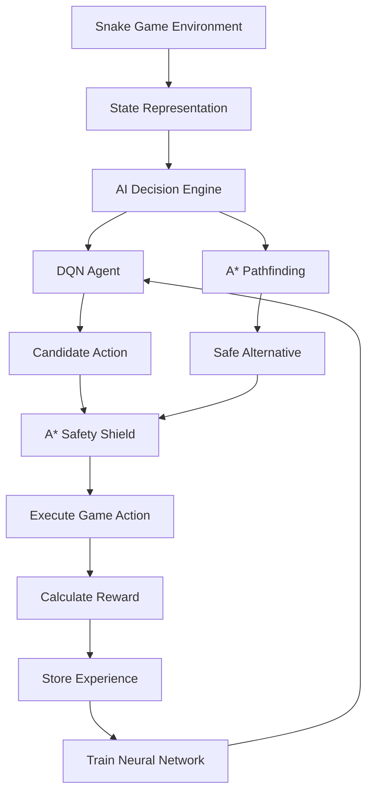
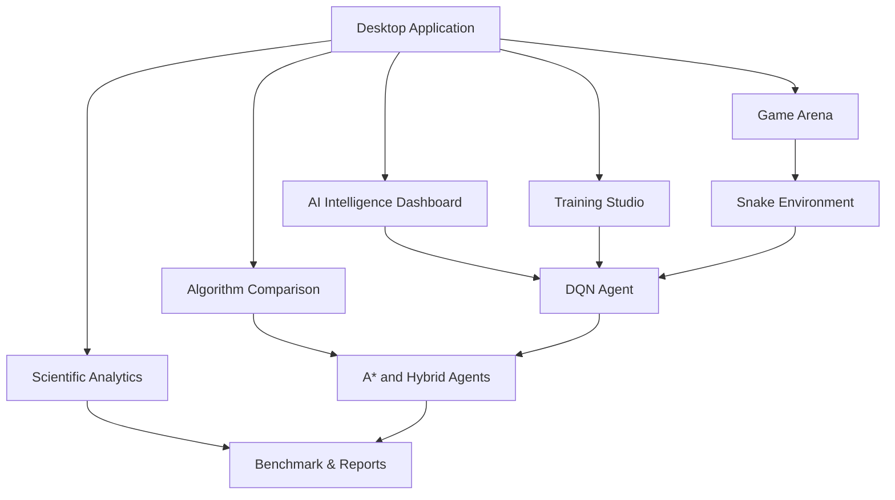

# 🐍 DQN SNAKE AI

### Deep Reinforcement Learning & Intelligent Pathfinding Platform

**An Autonomous Snake AI Powered by Deep Q-Networks, Advanced Reinforcement Learning, and A* Pathfinding*\*


\


---

## 🌐 Project Links

- 🐙 **GitHub Repository:** [DQN-Snake-AI](https://github.com/RahulRathod90/DQN-Snake-AI)
- 👨‍💻 **Developer:** Rahul Rathod
- 🎮 **Application:** Desktop-based AI platform
- 📖 **Documentation:** Project documentation included in the repository

---

## 📌 Table of Contents

- 🧠 Overview
- ✨ Key Features
- 🏗️ System Architecture
- 🧬 AI Models & Algorithms
- 🎯 Reinforcement Learning Methodology
- 📊 Benchmark Results
- 🖥️ Desktop Application
- 🧪 Technology Stack
- 📁 Repository Structure
- ⚙️ Installation & Setup
- 🚀 Running the Application
- 🧪 Testing
- 📈 Performance Analysis
- 🔮 Future Improvements
- 👤 Author
- 📜 License

---

## 🧠 Overview

DQN Snake AI is an intelligent game-playing platform that explores the capabilities of **Deep Reinforcement Learning (DRL)** and intelligent pathfinding algorithms.

The project trains an autonomous AI agent to play the classic Snake game by interacting with a game environment, observing states, taking actions, and learning from rewards and penalties.

Unlike traditional rule-based Snake games, the system uses Deep Q-Networks (DQN) to learn decision-making strategies through repeated interactions and experience replay.

The platform further integrates advanced reinforcement learning algorithms and A\* pathfinding to compare different decision-making approaches and improve navigation safety.

### 🌟 Core Philosophy

**1. Autonomous Learning**

The AI learns to navigate the game environment through trial and error rather than relying entirely on predefined movement rules.

**2. Intelligent Decision Making**

Deep Q-Networks estimate the expected future reward of available actions and select actions based on learned Q-values.

**3. Hybrid Intelligence**

Combines reinforcement learning with A\* search, collision detection, and safety mechanisms to evaluate alternative navigation strategies.

**4. Experimental Evaluation**

Provides benchmark comparisons between different AI agents using consistent evaluation conditions.

---

## ✨ Key Features

| Feature                          | Description                                                | Technology                 |
| -------------------------------- | ---------------------------------------------------------- | -------------------------- |
| 🧠 Deep Q-Learning               | Autonomous Snake gameplay using learned Q-values           | PyTorch, DQN               |
| 🔄 Experience Replay             | Stores previous transitions for training                   | Replay Memory              |
| ⚡ Double DQN                     | Reduces Q-value overestimation                             | Double Deep Q-Learning     |
| 🧩 Dueling DQN                   | Separates state-value and action-advantage estimation      | Dueling Network            |
| 🎯 Prioritized Experience Replay | Prioritizes important learning experiences                 | PER                        |
| 🗺️ A\* Pathfinding              | Calculates intelligent paths toward food                   | A\* Search                 |
| 🛡️ Safety Shield                | Filters dangerous actions and evaluates safer alternatives | Collision & Trap Detection |
| 📊 AI Dashboard                  | Displays AI intelligence and decision telemetry            | Desktop GUI                |
| 📈 Performance Analytics         | Visualizes benchmark results and training performance      | Matplotlib                 |
| 📁 Data Export                   | Exports analytical results                                 | CSV / JSON                 |

---

## 🏗️ System Architecture

The platform consists of a game environment, state representation, reinforcement learning agents, intelligent pathfinding, and an evaluation system.

### 1. AI System Workflow



### 2. Application Architecture



---

## 🧬 AI Models & Algorithms

The project implements multiple reinforcement learning and pathfinding approaches.

| Algorithm                     | Architecture / Method          | Purpose                                   |
| ----------------------------- | ------------------------------ | ----------------------------------------- |
| Original DQN                  | Fully Connected Neural Network | Baseline autonomous learning              |
| Double DQN                    | Double Q-Learning              | Reduces overestimation                    |
| Dueling DQN                   | Value and Advantage Streams    | Improves action-value estimation          |
| Prioritized Experience Replay | Priority-based Memory Sampling | Learns from important transitions         |
| Enhanced DQN                  | 24-D State Representation      | Uses additional environmental information |
| Pure A\*                      | Heuristic Search               | Intelligent route planning                |
| DQN + A\* Safety Shield       | Hybrid Decision System         | Filters unsafe actions                    |
| Optimized DQN                 | Tuned Dueling Network          | Improved baseline performance             |

### Neural Network & Learning Components

- **Policy Network:** Estimates Q-values for available actions.
- **Target Network:** Provides more stable training targets.
- **Experience Replay:** Stores previous state transitions.
- **Huber Loss:** Helps stabilize network optimization.
- **Gradient Clipping:** Controls excessively large gradients.
- **Reward Shaping:** Encourages food collection and safe navigation.
- **Epsilon-Greedy Strategy:** Balances exploration and exploitation.

---

## 🎯 Reinforcement Learning Methodology

The agent learns using the Markov Decision Process (MDP) framework.

### 1. State Representation

The environment provides two state configurations:

- Standard State: 11-dimensional representation.
- Enhanced State: 24-dimensional representation.

These representations encode relevant information about the snake, food, movement direction, and nearby dangers.

### 2. Action Space

The AI selects from four possible movement directions:

| Action | Movement |
| ------ | -------- |
| 0      | Up       |
| 1      | Down     |
| 2      | Left     |
| 3      | Right    |

### 3. Reward Optimization

The agent receives feedback from the environment based on its decisions.

- Positive reward: Collecting food.
- Negative reward: Collision with walls or the snake's body.
- Step-related penalties: Encourage efficient movement.
- Survival-related rewards: Encourage longer survival.

### 4. Q-Learning Optimization

The DQN agent estimates the expected cumulative reward for each possible action.

The standard Bellman target is:

[
Q\_{\text{target}} =
r+\gamma\max\_{a'}Q(s',a')
]

Where:

- (r) = Immediate reward
- (\gamma) = Discount factor
- (s') = Next state
- (a') = Possible next action

The network learns by minimizing the difference between predicted Q-values and training targets.

---

## 📊 Benchmark Results

The following results are from the project's reported 100-game evaluation benchmark.

**Evaluation conditions:** Random seed = 123, greedy policy ((\epsilon=0.0)).

| AI Agent                | Architecture      | Mean Score | Maximum Score |
| ----------------------- | ----------------- | ---------: | ------------: |
| Original DQN            | Standard FC, 11-D |      28.99 |            61 |
| DDQN + Dueling + PER    | Dueling FC, 11-D  |      26.69 |            63 |
| Enhanced 24-D DQN       | Dueling FC, 24-D  |      21.68 |            52 |
| Pure A\*                | Heuristic Search  |     222.75 |           474 |
| DQN + A\* Safety Shield | Hybrid Agent      |     118.36 |           182 |
| Optimized DQN           | Dueling FC, 11-D  |      31.52 |            71 |

### Performance Interpretation

- Pure A\* achieved the highest mean score in the reported benchmark.
- DQN + A\* Safety Shield outperformed the standalone DQN variants.
- Optimized DQN achieved the best mean score among the standalone DQN agents.
- The results demonstrate the difference between learned decision-making and heuristic-based planning.

*Note: These are project-specific experimental results, not guaranteed performance on other environments.*

---

## 🖥️ Desktop Application

The project includes an interactive desktop application designed for gameplay, AI monitoring, training, and algorithm comparison.

### Application Modules

**1. Game Arena**

- Human gameplay mode.
- Autonomous AI gameplay.
- Multiple AI agent selection.
- Adjustable game speed.

**2. AI Intelligence Dashboard**

- Q-value visualization.
- Action probability monitoring.
- Spatial risk analysis.
- Safety-shield activity.

**3. Algorithm Comparison Matrix**

- Compare different AI algorithms.
- Analyze benchmark scores.
- View performance statistics.

**4. Training Studio**

- Configure training parameters.
- Monitor learning progress.
- Observe training performance.

**5. Scientific Analytics**

- Benchmark visualization.
- Performance graphs.
- CSV and JSON data export.

### Keyboard Controls

| Key          | Function                |
| ------------ | ----------------------- |
| `Space`      | Pause / Resume          |
| `R`          | Restart Game            |
| `P`          | Toggle A\* Path Overlay |
| `1–5`        | Change Game Speed       |
| `Arrow Keys` | Manual Movement         |
| `W A S D`    | Manual Movement         |

---

## 🧪 Technology Stack

### Core Development

| Category                | Technologies    |
| ----------------------- | --------------- |
| Programming Language    | Python 3.10+    |
| Deep Learning Framework | PyTorch         |
| Reinforcement Learning  | Deep Q-Networks |
| Game Development        | Pygame          |
| Numerical Computing     | NumPy           |
| Data Visualization      | Matplotlib      |
| Pathfinding             | A\* Search, BFS |
| Testing                 | Python unittest |
| Application Packaging   | PyInstaller     |
| Version Control         | Git & GitHub    |

### System Requirements

- Python 3.10 or higher
- Windows / compatible Python environment
- Minimum 4 GB RAM recommended
- CPU support for basic execution
- CUDA-compatible GPU optional for accelerated training

---

## 📁 Repository Structure

```text
DQN-Snake-AI/
│
├── DQN-Snake-AI/
│   └── Core project modules
│
├── results/
│   └── Benchmark results and analysis
│
├── app.py
│   └── Desktop application entry point
│
├── streamlit_app.py
│   └── Streamlit application entry point
│
├── requirements.txt
│   └── Python dependencies
│
├── install.bat
│   └── Automated dependency installation
│
├── run.bat
│   └── Application launcher
│
├── test.bat
│   └── Test runner
│
├── build.bat
│   └── Windows executable build
│
├── clean.bat
│   └── Project cleanup utility
│
├── snake_ai.spec
│   └── PyInstaller configuration
│
├── .gitignore
│   └── Git ignored files
│
├── LICENSE
│   └── MIT License
│
└── README.md
    └── Project documentation
```

---

## ⚙️ Installation & Setup

### Prerequisites

Install the following:

- Python 3.10+
- Git
- pip package manager

### 1. Clone Repository

```bash
git clone https://github.com/RahulRathod90/DQN-Snake-AI.git

cd DQN-Snake-AI
```

### 2. Create Virtual Environment

```bash
python -m venv .venv
```

### 3. Activate Virtual Environment

**Windows PowerShell:**

```powershell
.\.venv\Scripts\Activate.ps1
```

**Linux / macOS:**

```bash
source .venv/bin/activate
```

### 4. Install Dependencies

```bash
python -m pip install --upgrade pip

pip install -r requirements.txt
```

---

## 🚀 Running the Application

### Option 1: Windows Quick Start

The project includes optional batch scripts for convenient execution.

```powershell
.\install.bat
.\run.bat
```

### Option 2: Manual Execution

Launch the desktop application:

```bash
python app.py
```

### Option 3: Streamlit Application

If you want to launch the Streamlit interface:

```bash
streamlit run streamlit_app.py
```

---

## 🧪 Testing

The project includes a Windows test launcher.

Run:

```powershell
.\test.bat
```

This executes the configured project test workflow.

For additional verification, use the testing scripts and test modules included in the repository.

---

## 📈 Performance Analysis

The project evaluates multiple approaches to autonomous gameplay.

The main evaluation metrics include:

- Average game score.
- Maximum game score.
- Survival performance.
- Food collection efficiency.
- Collision avoidance.
- Algorithm comparison.
- Learning and decision-making behavior.

The benchmark results help identify the strengths and limitations of reinforcement learning and search-based approaches.

---

## 🔮 Future Improvements

Potential future development includes:

1. **Advanced Deep Reinforcement Learning:** Explore Rainbow DQN and other advanced RL architectures.
2. **Improved State Representation:** Experiment with CNN-based spatial feature extraction.
3. **Adaptive Reward Optimization:** Improve reward functions for longer survival and efficient food collection.
4. **Multi-Environment Training:** Train agents across multiple parallel game environments.
5. **Enhanced AI Analytics:** Add more detailed learning curves and decision visualizations.
6. **Automated Hyperparameter Tuning:** Experiment with different learning rates, discount factors, and replay strategies.
7. **Cross-Platform Deployment:** Improve packaging and compatibility across operating systems.
8. **Extended Benchmarking:** Evaluate performance across multiple random seeds and larger game samples.

---

## 👤 Author & Contributor

**Developed by Rahul Rathod**

AI & Machine Learning Engineering Student

- 🐙 GitHub: [@RahulRathod90](https://github.com/RahulRathod90)
- 🧠 Project: [DQN-Snake-AI](https://github.com/RahulRathod90/DQN-Snake-AI)

---

## 📜 License

This project is licensed under the **MIT License**.

See the [LICENSE](LICENSE) file for more information.

---

\<p align="center">   \<b>🐍 DQN Snake AI\</b>\<br>   Intelligent Learning. Strategic Thinking. Autonomous Gameplay.   \<br>\<br>   Built with ❤️ by Rahul Rathod \</p>
